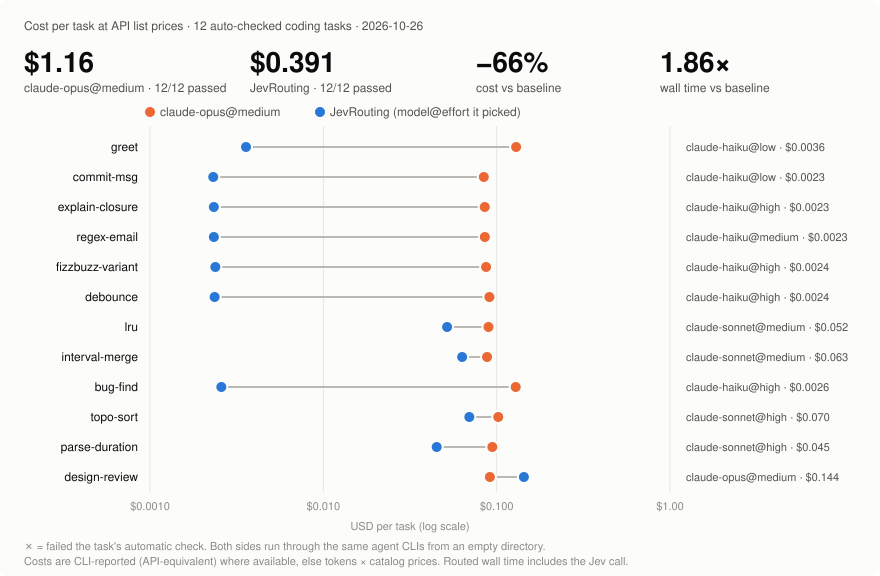
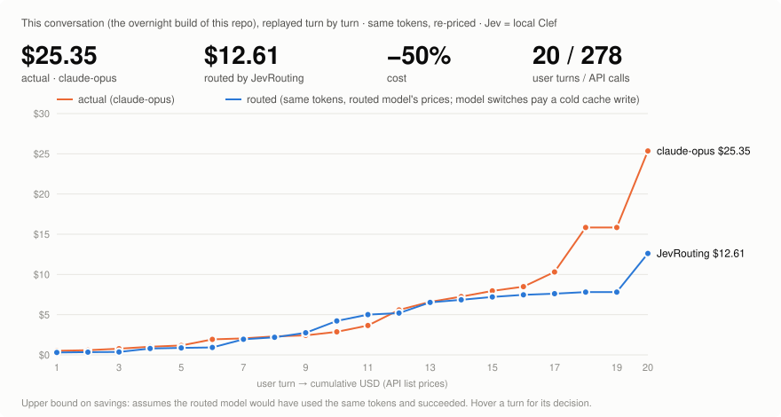
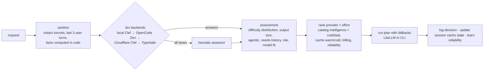

# JevRouting

A cost-, intelligence- and cache-aware router for coding agents. For every request it asks a **Jev System One** decision model what the task needs, then picks the **provider × effort** with the lowest *expected cost per successful task*. Model data comes from **Slopalytics**: Artificial Analysis benchmarks plus real T3 Code usage. It's cached locally and refreshed daily.

Providers are config, not code. Out of the box it routes across **Claude Code**, **Antigravity** and **OpenCode** (including free models), either through your **LiteLLM** proxy or by calling the CLIs directly.



<!-- BENCH-TABLE:START -->
| Task | Expected | claude-opus@medium | Routed to | Routed cost | Pass (base / routed) |
|---|---|---:|---|---:|:---:|
| greet | trivial | $0.130 | claude-haiku@low (Jev L0) | $0.0036 | ✅ / ✅ |
| commit-msg | trivial | $0.084 | claude-haiku@low (Jev L1) | $0.0023 | ✅ / ✅ |
| explain-closure | simple | $0.085 | claude-haiku@high (Jev L2) | $0.0023 | ✅ / ✅ |
| regex-email | simple | $0.085 | claude-haiku@medium (Jev L2) | $0.0023 | ✅ / ✅ |
| fizzbuzz-variant | simple | $0.087 | claude-haiku@high (Jev L2) | $0.0024 | ✅ / ✅ |
| debounce | moderate | $0.091 | claude-haiku@high (Jev L2) | $0.0024 | ✅ / ✅ |
| lru | moderate | $0.090 | claude-sonnet@medium (Jev L3) | $0.052 | ✅ / ✅ |
| interval-merge | moderate | $0.088 | claude-sonnet@medium (Jev L3) | $0.063 | ✅ / ✅ |
| bug-find | moderate | $0.129 | claude-haiku@high (Jev L2) | $0.0026 | ✅ / ✅ |
| topo-sort | hard | $0.102 | claude-sonnet@high (Jev L3) | $0.070 | ✅ / ✅ |
| parse-duration | hard | $0.094 | claude-sonnet@high (Jev L3) | $0.045 | ✅ / ✅ |
| design-review | hard | $0.091 | claude-opus@medium (Jev L5) | $0.144 | ✅ / ✅ |
| **Total** | | **$1.16** | | **$0.391** (−66%) | 12/12 / 12/12 |
<!-- BENCH-TABLE:END -->

**How to read this.** This is 12 real coding requests, each run once through Claude Code on Opus 5.5 at `medium` effort, and once through JevRouting, which used local Clef as Jev and the [CLI config](examples/cli.config.yaml). Both sides start from an empty directory. Every answer is checked automatically; the code answers are executed against test cases. Costs are what Claude Code reports, at API-equivalent prices. Three iterations of the cost model on the same tasks and baseline ([`bench/results/`](bench/results)):

| Run | Change | Routed total | vs Opus@medium | Pass |
|---|---|---:|---:|:---:|
| 1 | initial model | $0.534 | −54% | 12/12 |
| 2 | + harness-token overhead (~17.5K tokens per Claude Code call) | $0.611 | −47% | 12/12 |
| 3 | + one-shot thinking tokens per effort, provider cooldowns, Haiku@high allowed | **$0.391** | **−66%** | 12/12 |

Run 2 got *worse*. Once the fixed harness overhead was in the model, the price gap between efforts looked negligible, so the router drifted to Sonnet@high. Run 3 models the thinking tokens that higher efforts spend even on short answers, and that pushed simple and moderate work down to Haiku. Caveats:

- The suite is small and every task is a one-shot. Agentic, multi-turn work is where warm caches and context pruning matter, and this benchmark doesn't exercise them.
- Routed wall time includes the local Jev call, about 4.6 s on an M4. Hosted Jev is about 0.1–0.2 s.
- Free OpenCode models were in cooldown (quota exhausted) during these runs. With quota available, the router sends some of this work to them at $0 marginal cost.
- Reproduce with `npm run bench -- --baseline-from bench/results/run1.json` (reuses the Opus baseline) and `npm run bench:report -- <result.json> --readme README.md`.

## This conversation, replayed

This repo was built overnight in a single T3 Code thread, by one agent (Opus 5.5) and four delegated subagents. As the final test, the whole thread was replayed through the router:

1. **Export the thread in full from T3 Code.** [`scripts/export-t3-thread.ts`](scripts/export-t3-thread.ts) reads T3's local state DB read-only. It takes every turn item with its complete payload (messages, reasoning, tool calls and results, file changes), T3's own per-run token usage, and the same for every child thread. Output: [`bench/conversation/t3-thread-full.json.gz`](bench/conversation), 4.4 MB raw. Secrets are removed twice, by pattern and by scrubbing every `.env` secret value *and any 6+ char fragment of it*.
2. **Replay it.** [`bench/conversation.ts`](bench/conversation.ts) takes each user turn (full text) from the export, plus exact per-call usage from the session transcript. It asks the router (**Jev = local Clef**, with the conversation so far as history) which provider×effort it would use. Then it re-prices **the same tokens** at that model's prices. A model switch pays a cold cache write for the whole context, and a replay clock decides which caches are still warm.
3. **Cross-check.** T3's own usage totals are compared against the transcript, and the subagent threads are priced at the models they actually ran on.



<!-- CONVERSATION-TABLE:START -->
| # | User turn | API calls | Jev | Routed to | Actual (claude-opus) | Routed |
|---:|---|---:|---|---|---:|---:|
| 1 | Plan from argon on high is in the root. ( don't trust it, sh… | 6 | Clef L4 | claude-sonnet@high ↺ | $0.51 | $0.30 |
| 2 | 1. opencode console: jev-1.13-free; temp key for you: [REDAC… | 2 | Clef L3 | claude-sonnet@high | $0.08 | $0.04 |
| 3 | use worktrees, but you may do pr's and aproove them to main… | 5 | Clef L3 | opencode-glm-flash@max ↺ | $0.19 | $0.02 |
| 4 | litellm - what i use to route to claudecode, antigravity, op… | 7 | Clef L3 | claude-sonnet@high ↺ | $0.25 | $0.43 |
| 5 | you may use any dependencies you want, anything actually… | 2 | Clef L3 | claude-sonnet@high | $0.15 | $0.07 |
| 6 | i also want local ( cached ) + updates once a day from slopp… | 18 | Clef L3 | opencode-deepseek-flash@max ↺ | $0.76 | $0.06 |
| 7 | And figure out what and how to feed jev, since i don't fully… | 2 | Clef L4 | claude-opus@medium ↺ | $0.13 | $1.02 |
| 8 | you may also feed it models to pick from. you have the freed… | 3 | Clef L4 | claude-opus@medium | $0.25 | $0.25 |
| 9 | And the readme should contain a good visualisation of cost (… | 2 | Clef L4 | claude-sonnet@high ↺ | $0.13 | $0.56 |
| 10 | what would you change about the arhirtecture, flows, etc? to… | 5 | Clef L5 | claude-opus@medium ↺ | $0.44 | $1.47 |
| 11 | [Assistant quote](t3-citation://v1/9a1a57b7-f241-44a3-bca3-d… | 10 | Clef L4 | claude-opus@medium | $0.79 | $0.79 |
| 12 | if data is not available on slopalitics, configurable on/off… | 25 | Clef L3 | opencode-glm-flash@max ↺ | $1.93 | $0.19 |
| 13 | also, the gemini plan seems incomplete locally, here it is i… | 19 | Clef L4 | claude-sonnet@xhigh ↺ | $1.01 | $1.33 |
| 14 | and the full verbose plan here: https://share.gemini.google/… | 11 | Clef L4 | claude-sonnet@high | $0.65 | $0.32 |
| 15 | what do you want credentials too?… | 8 | Clef L4 | claude-sonnet@high | $0.71 | $0.35 |
| 16 | [REDACTED] - workers ai api token - no credit on it… | 7 | Clef L4 | claude-sonnet@high | $0.53 | $0.26 |
| 17 | You may get this locally: mlx-community/clef-flash-4bit… | 22 | Clef L3 | opencode-deepseek-flash@max ↺ | $1.82 | $0.14 |
| 18 | ok. mention in the readme the setup and altency vs jev hoste… | 62 | Clef L2 | opencode-deepseek-flash@max | $5.53 | $0.20 |
| 19 | and don't forget at the end to actually run it ( at least in… | 1 | Clef L3 | opencode-glm-flash@max ↺ | $0.00 | $0.00 |
| 20 | Continue where you left off.… | 84 | Clef L3 | claude-sonnet@high ↺ | $12.06 | $6.08 |
| 21 | /goal finish implementation + testing ( against this t3 thre… | 20 | Clef L3 | claude-sonnet@high | $2.50 | $1.25 |
| | **Total** | **321** | | | **$30.40** | **$15.14** (−50%) |
<!-- CONVERSATION-TABLE:END -->

**What it shows.**

- Every decision came from **local Clef**, averaging 6.2 s per call with up to 3 turns of history.
- The savings come from routine turns: config tweaks, README edits, the long "continue" turns. Those went to Sonnet or to free models instead of Opus.
- The losses are **cold switches**. Turns 7, 9 and 10 each moved to a different model, and each switch paid a full cache write on 60–120K tokens. Those switches cost more than staying on the warm model would have, even at the higher price.
- So a stickier switching policy is the obvious next tuning. For example, require the predicted saving to exceed the switch penalty by a margin, or judge it over the expected remaining turns rather than the current one.

Read this as an **upper bound**. It assumes the routed model would have done each turn's work in the same number of tokens, and succeeded. That's optimistic for the long agentic turns the router sent to free OpenCode models. The switching penalty and Jev's own cost, which is zero locally, are included.

- **Subagents:** the four subagent threads (three Haiku 5.5, one free DeepSeek) are priced from T3's usage and are identical on both sides: about $0.36 in total.
- **Cross-check:** T3's run totals match the transcript to within about 10%. The difference is the run that was still in progress at export time, which T3 hadn't finalized.

To reproduce:

```bash
npx tsx scripts/export-t3-thread.ts <threadId>          # → bench/conversation/t3-thread-full.json.gz
npx tsx bench/conversation.ts --transcript ~/.claude/projects/<project>/<session>.jsonl
npx tsx bench/conversation-report.ts --readme README.md
```

## How a request is routed



1. **Sanitize.** Secrets are redacted. Jev sees the current ask, at most 3 recent *user* turns within an 8,000-char budget (assistant code dumps hurt calibration), and **facts computed in code**: diff size, files touched, repeated test failures, context size. Jev is calibrated but can't count or do arithmetic, so it never gets raw numbers to compare.
2. **Assess (one Jev call, all questions in one forward pass).**

   | Question | Type | Used for |
   |---|---|---|
   | `difficulty` | score, 6 levels (trivial → frontier) | required intelligence, as a full **distribution** |
   | `outputSize` | score, 4 levels | output-token estimate |
   | `agentic` | noul | weights per-task (agent loop) vs one-shot token cost |
   | `needsHistory` | noul | prune history on handoff (prevents cold-cache re-prefill on a switch) |
   | `risk` | score, 4 levels | raises the intelligence bar; ≥ 2.5 requires `--approve` |
   | `modelFit` | choice over your providers' `strengths` | small, capped bonus in ranking (Jev never sees prices) |
   | `kind`, `latencySensitive` | choice / noul | opt-in (`classifier.extendedQuestions`); otherwise cheap regex |

   Deterministic rules then adjust the distribution. Repeated test failures shift it up one level. A diff over 1,000 lines puts a floor at level 3.
3. **Rank.** Every enabled provider at every effort it allows (with its own Slopalytics variant) becomes a candidate:

   ```
   P(success)  = Σ_level  p(level) · σ((I_variant − I_required(level)) / spread)  ×  reliability
   attempt $   = billingMultiplier × [ agentic·(costPerTask·sizeScale + prefill)
                                     + (1−agentic)·(prefill + outTokens·verbosity·outPrice) ]
   prefill     = contextTokens × (cache warm ? cacheReadPrice : cacheWritePrice)
   objective   = (attempt $ + latencyWeight·minutes) / P(success)  ÷  modelFitBonus
   ```

   - **Effort is chosen too.** Sonnet@high competes against Opus@medium using each variant's own intelligence, cost per task, tokens and time.
   - **Cache-aware.** Each session remembers which provider it last used, when, and how much context it holds. Within that provider's TTL (Anthropic 5 min, OpenAI 30 min, DeepSeek hours…) the candidate pays cache-*read* prices for the context; otherwise it pays cache-*write*. This is the plan's stay-vs-switch inequality, applied with real prices and expiry.
   - **Billing-aware.** `metered` pays list price, `subscription` (Claude Code, Antigravity) is weighted ×0.15 for quota, and `free` (OpenCode free models) ×0.02.
   - **Reliability.** Each candidate starts from the T3 Code completion rate (Slopalytics) and is updated by your own outcomes (a Beta posterior per provider+effort; send feedback via `/v1/jev/feedback`).
   - **Caps and floors.** `maxIntelligence` per provider (e.g. small free models), plus a `minSuccess` floor.
4. **Run** the plan: the winner, then fallbacks on *distinct* providers. Quota and sign-in errors don't count against a model's reliability.
5. **Log** one JSONL row per decision: state hash, Jev answers, the candidate table, attempts and outcome. That's enough to recalibrate `intelligenceByLevel` from real data later.

## Quick start

```bash
npm install
cp .env.example .env          # add whatever backends/keys you have
npm run build && npm link     # or use `npx tsx src/cli.ts …`

jev decide "Refactor the auth middleware to support OAuth2 PKCE across our 6 services"
jev route  "Write a one-line commit message for renaming getUser to fetchUser"
jev route --config examples/cli.config.yaml "…"   # talk to the CLIs directly, no LiteLLM
jev serve --port 4100                             # OpenAI-compatible proxy
jev catalog refresh                               # force a Slopalytics refresh
```

`jev decide` prints the full reasoning:

```
assessment: jev (clef-flash, 4593ms)
  kind=refactor level=4 needs I≥52 risk=1.85 agentic=0.82 history=0.08
candidates:
  ✓ claude-opus@medium             I=51.2 p=0.68 cost=  $0.140 (list $0.934) ~2.3min
  ✓ claude-sonnet@xhigh            I=51.9 p=0.70 cost=  $0.211 (list $1.406) ~5.1min
plan: claude-opus@medium → claude-sonnet@xhigh
```

### OpenAI-compatible proxy

`jev serve` exposes `/v1/chat/completions`. Use `model: "jev-auto"` to route, or a provider id to pin one. `reasoning_effort` pins an effort. The session comes from `x-jev-session-id`, `x-litellm-session-id`, `x-claude-code-session-id`, `metadata.session_id` or `user`. Responses carry a `jev` block with the decision, plus the headers `x-jev-provider`, `x-jev-effort` and `x-jev-cost-usd`. High-risk tasks return **409** with the decision; resend with `"jev": {"approve": true}`. The server also has `POST /v1/jev/decide` (plan only) and `POST /v1/jev/feedback` (`{providerId, effort, ok}`). Set `JEV_SERVER_KEY` to require a bearer token.

## Configuring providers

Everything lives in [`jev.config.yaml`](jev.config.yaml) (LiteLLM-backed) or [`examples/cli.config.yaml`](examples/cli.config.yaml) (direct CLIs). Strings support `${ENV}` and `${ENV:-default}`.

```yaml
providers:
  claude-sonnet:
    kind: litellm                       # litellm | cli | mock
    model: claudecode/claude-sonnet-5-5 # your LiteLLM model_name
    catalogId: claude-sonnet-5-5        # Slopalytics family (inferred from model when omitted)
    billing: subscription               # metered | subscription | free
    efforts: [low, medium, high, xhigh] # efforts the router may pick
    strengths: Strong all-round coder; features, refactors, tests and reviews.
  opencode-glm-flash:
    kind: cli
    preset: opencode                    # claude-code | opencode | antigravity, or custom command/args
    model: opencode/glm-5.3-flash-free
    billing: free
    maxIntelligence: 46                 # never send it tasks needing more
```

Optional per provider: `pricing` (USD per 1M tokens, overrides the catalog), `cacheTtlSec`, `effortMap` (e.g. DeepSeek only accepts low/high/max), `intelligence` / `costPerTask` priors for models no catalog knows, `timeoutMs` and `enabled`. To swap a backend, change `model` (and `catalogId`), or add a block. `routing.only` and `routing.fallback` restrict or extend the pool.

## Model data: Slopalytics first, cached daily

| Source | What it gives | Default |
|---|---|---|
| **[Slopalytics](https://slopalytics.com)** | ~700 model × effort variants: AA intelligence, cost per task, tokens per task, time, speed, list prices; real T3 Code usage: cache-aware prices, completion rate, cache hit rate | on (primary) |
| **[models.dev](https://models.dev)** | pricing incl. cache read/write and context for models Slopalytics lacks | on (gap-fill) |
| **[Artificial Analysis API](https://artificialanalysis.ai/documentation)** | intelligence index for models Slopalytics lacks | on if `AA_API_KEY` is set |

Slopalytics has no JSON API for benchmarks, so the variants are parsed from its JS bundle with a strict literal parser (no `eval`); usage comes from `/data/t3-usage.json`. Each source is cached under `~/.cache/jev-routing/` and refreshed at most once per `catalog.maxAgeHours` (24). Writes are atomic and guarded by a lock. If a refresh fails, the router uses the stale cache, and failing that a **bundled snapshot**, so it never runs without data. Toggle sources under `catalog.sources`.

## Jev backends: hosted vs local

Any System One-compatible endpoint works. They're tried in order; one is skipped when its env vars are empty, and a backend that returns 429 is skipped until its `Retry-After`:

| Backend | Model | Setup | Latency (this router's request) |
|---|---|---|---|
| **Local Clef (MLX)** | `clef-flash-4bit` | `scripts/clef-serve.sh`, then `JEV_LOCAL_URL=http://127.0.0.1:8765/v1` | **~4.6 s** on an M4/16 GB for the 6-question request (~1.1K tokens); ~0.9 s for a single short question |
| **OpenCode Zen** | `jev-1.13-free` | `JEV_API_KEY` (OpenCode key) | hosted TypeSafe Jev, same model (~0.1–0.2 s expected). Not measured here: the shared free quota on the test key stayed exhausted (`429 FreeUsageLimitError`), and the 429 itself comes back in ~0.45 s |
| **Cloudflare Workers AI** | `clef-flash` | `CLOUDFLARE_ACCOUNT_ID` + `CLOUDFLARE_AUTH_TOKEN` (10K free neurons/day) | provider-reported ~0.2 s |
| **TypeSafe direct** | `jev-1.13.0` | `TYPESAFE_API_KEY` | ~127 ms p50 / 231 ms p95 (LiteLLM benchmark) |

On local Clef, latency grows roughly linearly with input tokens (~4 ms per token on an M4). That's why the default question set is lean and the rubrics are short. Hosted Jev evaluates all questions in parallel, so `classifier.extendedQuestions: true` costs almost nothing there. Local Clef wins on privacy, has no quota, and is free. Hosted Jev wins on latency. If every backend is down, a conservative heuristic assessor takes over and the decision log records why.

```bash
scripts/clef-serve.sh                                     # creates a venv, downloads ~6 GB once, serves on :8765
CLEF_MODEL=mlx-community/clef-4bit scripts/clef-serve.sh  # 27B variant, needs a 32 GB+ Mac
```

## What changed from the original (Gemini "argon") plan

- **Jev assesses; it no longer picks a tier.** A static 4-tier → model map ignores the data. Here Jev estimates *what the task needs* (as a distribution), and code optimizes over the live catalog, including effort.
- **Fixed API misuse.** `noul` takes no `criteria`. The `@typesafe-ai/sdk` package and LiteLLM's `classifier_type: jev` from the plan don't exist, so the client here is a small `fetch` wrapper. The plan's fallback branch dropped fields such as `effortLevel`.
- **Uncertainty is used, not thrown away.** P(success) integrates over the difficulty distribution. Picking one level (or a quantile) biased routing upward by about one level in practice.
- **Cache economics are computed per candidate** with real prices and TTL expiry, instead of a one-off worked example.
- **Dropped:** Kubernetes pod discovery, Bedrock load balancing and Copilot quota arbitrage (irrelevant when driving CLIs or LiteLLM), plus the hard-coded benchmark tables (they're fetched daily now).
- **Added:** learned reliability, an approval gate, an OpenAI-compatible proxy, a Jev failover pool, local Clef, a heuristic fallback, and secondary catalog sources.

## Development

```bash
npm test                       # unit + integration (mock LiteLLM server, fake CLIs, fixtures)
JEV_LIVE=1 npm run test:live   # live: Slopalytics, OpenCode free model
npm run typecheck
npx tsx bench/run.ts --config examples/cli.config.yaml   # baseline vs routed benchmark
npx tsx bench/report.ts bench/results/<run>.json         # → docs/cost-comparison.svg + table
```

Layout: `src/jev` (System One client + failover pool) · `src/catalog` (Slopalytics, models.dev, AA, cache) · `src/router` (assessment, ranking, sessions, outcomes, engine) · `src/providers` (LiteLLM, CLI, mock) · `src/server.ts` · `src/cli.ts` · `bench/`.
